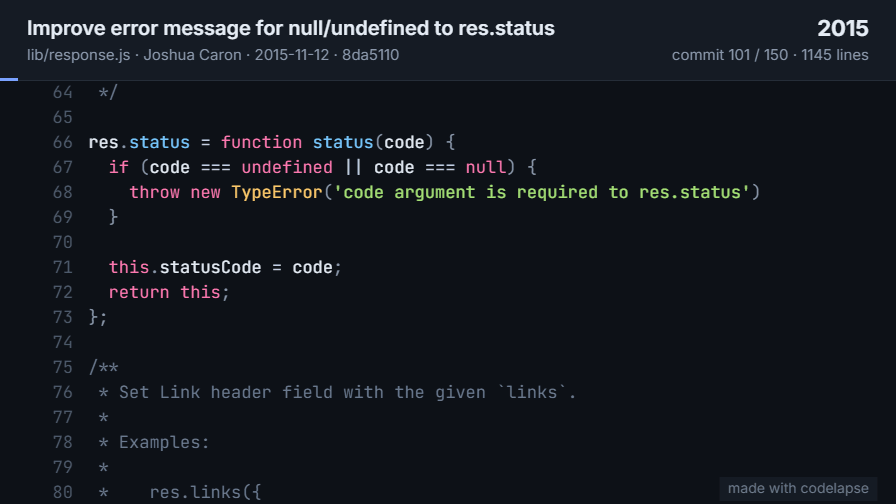
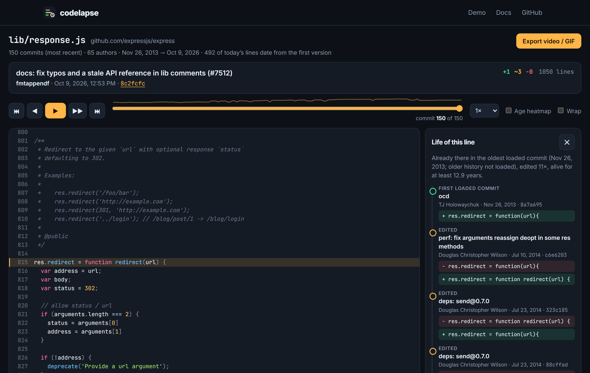

<div align="center">

# codelapse

**Watch any file grow up.**

A time-lapse of a file's git history. Lines slide into place as the code evolves, every line can
tell you its life story, and the whole thing exports as an MP4 or GIF.

[**Open the website**](https://feresbr1.github.io/codelapse/) ·
[Play a demo](https://feresbr1.github.io/codelapse/#/demo/express-response) ·
[Releases](https://github.com/feresbr1/codelapse/releases) ·
[Issues](https://github.com/feresbr1/codelapse/issues)



<sub>The last 50 commits of Express's <code>lib/response.js</code>, exported as a GIF by codelapse itself.</sub>

</div>

## Try it

**On any GitHub file:** paste its link at [feresbr1.github.io/codelapse](https://feresbr1.github.io/codelapse/),
or change the URL by hand:

```text
https://github.com/expressjs/express/blob/master/lib/response.js
https://feresbr1.github.io/codelapse/#/gh/expressjs/express/master/lib/response.js
```

**On any local repository** (private, self-hosted, any host), from inside it:

```console
$ npx github:feresbr1/codelapse lib/response.js
codelapse: lib/response.js · 300 commits (most recent 300; use -n for more) · 86 authors · read in 826 ms
codelapse: wrote C:\Users\me\AppData\Local\Temp\codelapse\lib_response.js-1792457679294.html
```

That's real output on a clone of Express (Windows, home folder renamed). The CLI opens the player in your browser; the HTML file
works offline and can be sent to anyone.



## What you get

- **Lines that move.** Every line keeps its identity across commits. Unchanged code slides when lines
  are added above it, edited lines flash amber, new lines fade in green, deleted lines fade out red.
- **The life of a line.** Click any line: who wrote it and when, every edit since (before and after),
  whether it was deleted, and how long it has lived. Like `git blame`, but the whole story instead
  of the last change. `codelapse file.js:42` opens with line 42 selected.
- **Export the time-lapse.** MP4 (or WebM/GIF where the browser can't encode H.264), in 16:9, square
  or vertical, for the last N commits, 8–60 seconds long. The camera follows the changes. Everything
  is rendered on your device.
- **Follows renames.** The CLI uses `git log --follow`, so history doesn't stop where a file was
  moved. The [Chalk demo](https://feresbr1.github.io/codelapse/#/demo/chalk-index) has 97 commits
  through a rename; the GitHub API alone returns 29 for the same file.
- **Age heatmap**, line numbers, commit hash with a link to the commit, syntax highlighting for about
  30 languages, a wrap toggle for long lines, and a sparkline of the file's size over time.
- **Keyboard:** <kbd>←</kbd> <kbd>→</kbd> step, <kbd>Space</kbd> play, <kbd>Home</kbd>/<kbd>End</kbd>
  first/latest commit.

## CLI

Requires **git** and **Node.js 20+**.

```text
codelapse <file>[:line] [options]

  -n, --max <count>    Most recent commits to include (default 300)
  --rev <revision>     Start from this branch, tag or commit (default HEAD)
  -o, --out <file>     Write the player to this HTML file (default: a temporary file)
  --json <file>        Also write the raw history as JSON (open it on the website)
  --no-open            Don't open the browser
```

```sh
codelapse src/index.ts                 # the last 300 commits of a file
codelapse README.md:12                 # open with line 12's story selected
codelapse lib/router.js -n 1000 -o router-history.html
codelapse src/app.ts --rev v2.0.0      # history up to a tag
codelapse lib/old-module.js            # files deleted since still have a history
```

Install it to drop the `npx github:` prefix (`npm install -g github:feresbr1/codelapse`), or download
`codelapse.mjs` from the [latest release](https://github.com/feresbr1/codelapse/releases/latest) and
run `node codelapse.mjs <file>`.

It reads history with one `git log --follow` and one `git cat-file --batch` stream: about a second
for 300 versions of a 1,000-line file. In partial ("blobless") clones, all versions are fetched in a
single request instead of one round trip each. On Express's `lib/response.js` that took 3.6 s
instead of 384 s.

## Website

- Paste a GitHub file link, or use `#/gh/<owner>/<repo>/<ref>/<path>` links, which can be shared.
- Anonymous GitHub API access allows 60 requests an hour. codelapse uses one API request per 100
  commits and downloads file versions from raw.githubusercontent.com, which doesn't count against
  that limit. If you hit the limit, paste a read-only token; it stays in the tab.
- Open a history saved with `codelapse --json` (e.g. from a private repo) with _open a history .json_.
- Demos: [Express](https://feresbr1.github.io/codelapse/#/demo/express-response),
  [Preact](https://feresbr1.github.io/codelapse/#/demo/preact-diff),
  [Chalk](https://feresbr1.github.io/codelapse/#/demo/chalk-index), recorded with the CLI from those
  MIT-licensed repositories.

Nothing goes through a server of ours: the site is static, and data comes straight from GitHub to
your browser.

## Limitations

- The website follows a single path (the GitHub API doesn't follow renames). Use the CLI for full
  history across renames.
- The website reads files from GitHub only. Other hosts work through the CLI on a local clone.
- Text files only; files over 4,000 lines are shown without motion to stay fast.
- Line identity is inferred from diffs. When a block is rewritten heavily, lines count as deleted and
  re-added rather than edited.
- Video encoding needs a browser with WebCodecs (verified in Chrome). GIF export works everywhere.

## Development

```sh
npm install
npm run check        # format, lint, typecheck, unit + git/CLI tests, build
npx playwright install chromium
npm run test:e2e     # the website and player, desktop and mobile
npm run dev          # the website
npm run build:cli && npm run demos   # re-record the demo histories
```

Tech: TypeScript, Preact + Vite, esbuild (single-file CLI), Prism (highlighting), Mediabunny
(MP4/WebM, MPL-2.0) and gifenc (GIF) for export, Vitest, Playwright. Third-party notices are in
[THIRD_PARTY_NOTICES.md](THIRD_PARTY_NOTICES.md).

See [CONTRIBUTING.md](CONTRIBUTING.md), and the reasoning behind the project in
[docs/PRODUCT_DECISIONS.md](docs/PRODUCT_DECISIONS.md).

## License

[MIT](LICENSE)
